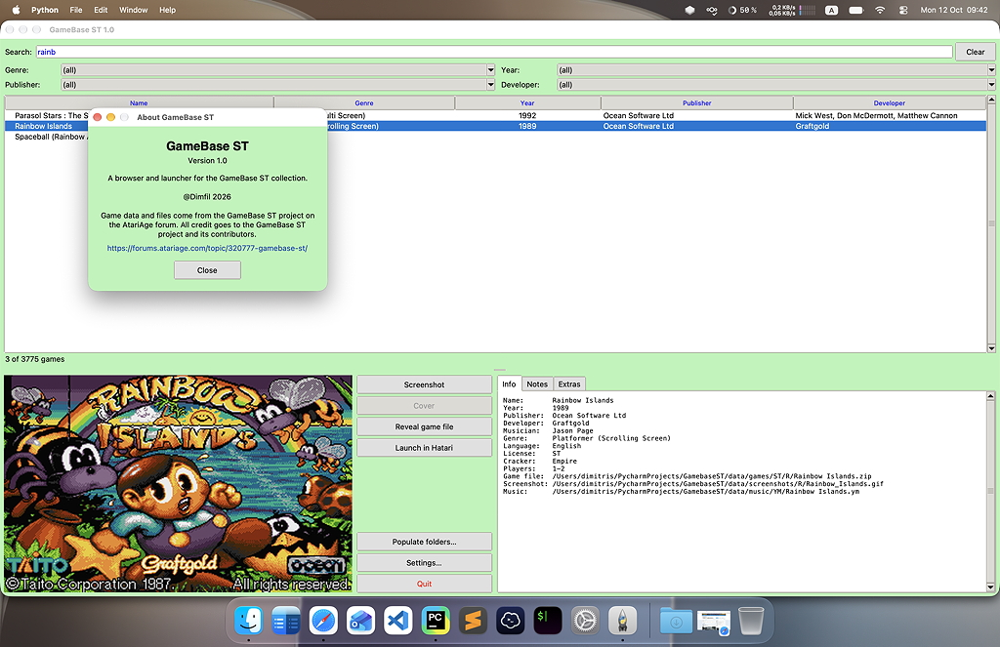
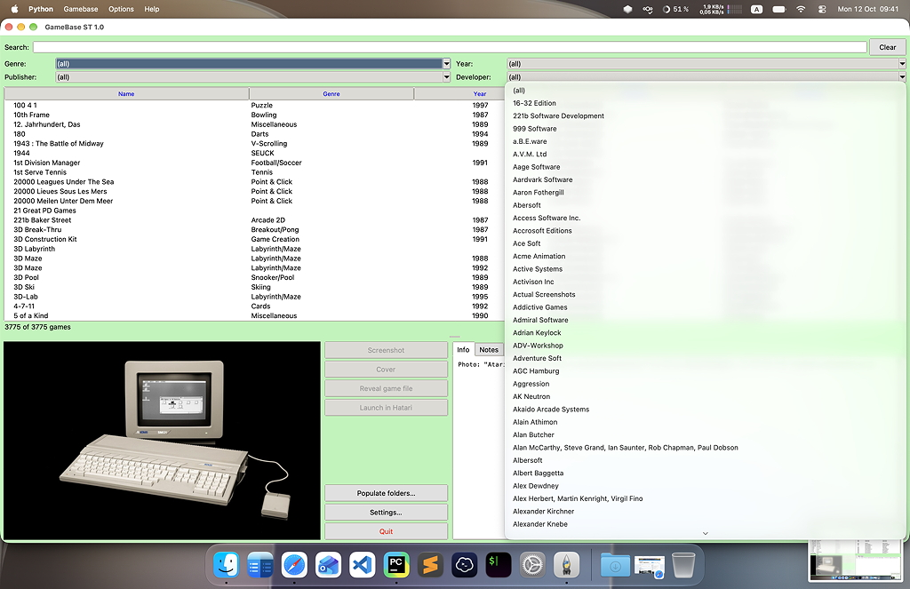
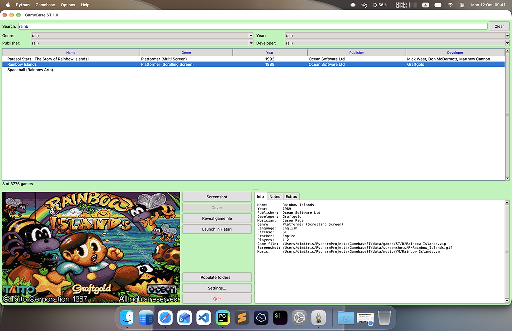
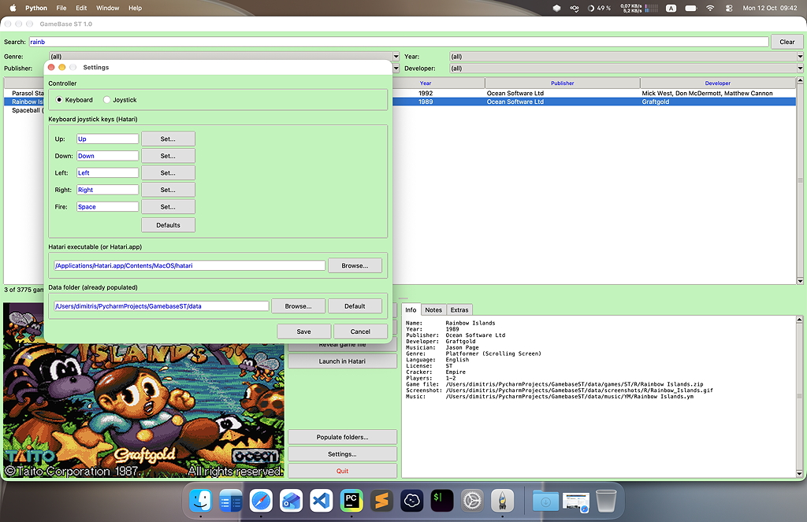
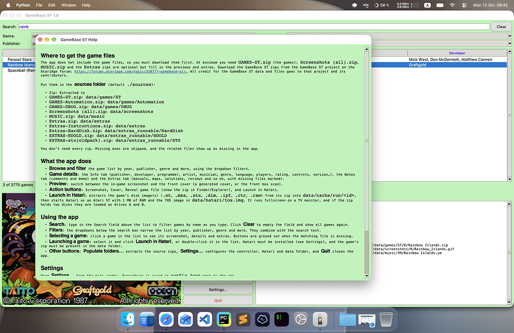
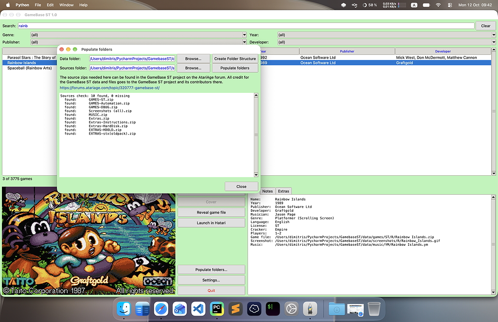

# GamebaseST Browser and Player

GamebaseST Browser and Player is a desktop browser and player for the **GameBase ST** collection of Atari ST games. It reads the bundled game database (`atarist.sqlite3` converted from original mdb file for easier access), shows each game's metadata, screenshot, cover, music and extras (manuals, maps, hints, box scans…), and launches games in the [Hatari](https://hatari.tuxfamily.org/) emulator with one click.

The app does not ship the game files. You supply the GameBase ST source zips, and the app extracts them into a `data/` folder.

## What the app does

- **Browse and filter** the game list by year, publisher, genre and more, using the dropdown filters.
- **Game details**: the *Info* tab (publisher, developer, programmer, artist, musician, genre, language, players, rating, controls, version…), the *Notes* tab (comments and memo) and the *Extras* tab (manuals, maps, solutions, reviews and so on, with missing files marked).
- **Preview**: switch between the in-game screenshot and the front cover (a generated cover, or the front box scan).
- **Action buttons**: *Screenshot*, *Cover*, *Reveal game file* (show the zip in Finder/Explorer), *Launch in Hatari*, and *Create standalone app…*.
- **Launch in Hatari**: extracts the game's disk image(s) (`.st`, `.msa`, `.stx`, `.dim`, `.ipf`, `.ctr`, `.raw`) from its zip into `data/cache/run/<id>`, then starts Hatari as an Atari ST with 1 MB of RAM and the TOS image in `data/hatari/tos.img`. It runs fullscreen on a TV monitor, and if the zip holds two disks they are loaded as drives A and B.

## Screenshots

**About**



**Main window with the filter dropdowns**



**Searching and selecting a game**



**Settings**



**Help**



**Populate folders**



## Using the app

- **Search**: type in the *Search* field above the list to filter games by name as you type. Click **Clear** to empty the field and show all games again.
- **Filters**: the dropdowns below the search box narrow the list by year, publisher, genre and more. They combine with the search text.
- **Selecting a game**: click a game in the list to see its screenshot, details and extras. Buttons are greyed out when the matching file is missing.
- **Launching a game**: select it and click **Launch in Hatari**, or double-click it in the list. Hatari must be installed (see *Settings*), and the game's zip must be present in the data folder.
- **Create standalone app…**: bundles the selected game into an app for the operating system you are running, with Hatari, a TOS image (you choose EmuTOS or your own original TOS, after a copyright notice that makes you fully responsible for what you share), the game's disk image(s), your joystick settings, and the game's screenshot as a splash screen and icon. macOS gives `<Game>.app`; Windows and Linux give a `<Game>` folder with the executable in it (zip it to share). Game saves are kept in the user's data folder (`~/Library/Application Support`, `%APPDATA%` or `~/.local/share`). Requirements: [PyInstaller](https://pyinstaller.org/) (`pip install pyinstaller pillow`) in the Python that runs GamebaseST; it cannot cross-compile, so build on the OS you are targeting. EmuTOS is taken from your Hatari install (the free image shipped with Hatari for macOS and Windows) or from `data/hatari/emutos.img`; your own `data/hatari/tos.img` is only bundled if you pick it in the dialog. On macOS the app is ad-hoc signed, so on another Mac the first launch needs right-click → Open. On Linux only the `hatari` binary is bundled, so the target needs SDL2 installed.
- **Other buttons**: **Populate folders…** extracts the source zips, **Settings…** configures the controller, Hatari and data folder, and **Quit** closes the app.

## Requirements

- Python 3 with Tk (the standard `tkinter`)
- [Pillow](https://python-pillow.org/) and [PyInstaller](https://pyinstaller.org/) (`pip install -r requirements.txt`). PyInstaller is only needed for *Create standalone app…* and for building the app.
- [Hatari](https://hatari.tuxfamily.org/) to launch games. Browsing works without it.
- A TOS image saved as `data/hatari/tos.img`. The repository does not include one, because TOS is copyrighted: supply your own dump of an Atari ST ROM, or use the free [EmuTOS](https://emutos.sourceforge.io/). **TOS 1.04 (Rev. 2) is recommended** for the best game compatibility. The `data/hatari/atari_keys` Hatari config is included.

Run the app:

```sh
python gamebaseST.py
```

## Populating the folders

The app finds files under a **data folder** (default `./data` next to the app). Its layout is:

```
data/
├── games/              game zips        (ST/, Automation/, DBUG/)
├── screenshots/        in-game screenshots
├── music/              MOD, MP3, SNDH, Sc68, YM
├── extras/             manuals, maps, hints, reviews, box scans…
├── extras_runnable/    extras that can run in the emulator (HardDisk, HDOLD, STX)
├── covers/             generated front covers ({GA_Id}.jpg)
├── cache/              temporary disk images created at launch
└── hatari/             tos.img, atari_keys (and hatari.exe on Windows)
```

### 1. Get the source zips

The app does not include the game files, so you must download them first. At minimum you need `GAMES-ST.zip` (the games); `Screenshots (all).zip`, `MUSIC.zip` and the `Extras` zips are optional but fill in the previews and extras. Download the GameBase ST zips from the GameBase ST project on the AtariAge forum: <https://forums.atariage.com/topic/320777-gamebase-st/>. All credit for the GameBase ST data and files goes to that project and its contributors.

Put them in the **sources folder** (default `./sources`):

| Zip | Extracted to |
| --- | --- |
| `GAMES-ST.zip` | `data/games/ST` |
| `GAMES-Automation.zip` | `data/games/Automation` |
| `GAMES-DBUG.zip` | `data/games/DBUG` |
| `Screenshots (all).zip` | `data/screenshots` |
| `MUSIC.zip` | `data/music` |
| `Extras.zip` | `data/extras` |
| `Extras-Instructions.zip` | `data/extras` |
| `Extras-HardDisk.zip` | `data/extras_runnable/HardDisk` |
| `EXTRAS-HDOLD.zip` | `data/extras_runnable/HDOLD` |
| `EXTRAS-stx(oldpack).zip` | `data/extras_runnable/STX` |

You don't need every zip. Missing ones are skipped, and the related files show up as missing in the app.

### 2. Extract them

**From the app:** click **Populate folders…**.

1. Optionally pick a different *Data folder* and *Sources folder* with **Browse…**. The dialog checks the sources folder straight away and lists each expected zip as found, MISSING, UNREADABLE or not needed.
2. Click **Create Folder Structure** to create the empty `data/` tree.
3. Click **Populate folders** to extract the zips. Progress appears in the log.

**From the command line:**

```sh
python populate.py --dry-run   # show what would be extracted
python populate.py             # extract
python data_audit.py           # just create the folder tree
```

Re-running is safe. Files that already exist with the same size are skipped, and unsafe zip paths are ignored.

On first start, if `data/games` holds no files, the app tells you the data needs populating.

Names are matched case-insensitively and ignore macOS/Windows Unicode differences, so a collection extracted on one OS works on another.

## Settings

Open **Settings…** from the main window. Everything is saved in `config.json` next to the app.

| Setting | What it does |
| --- | --- |
| **Controller** | *Keyboard* maps a joystick onto keys. *Joystick* uses a real gamepad or joystick in Hatari. |
| **Keyboard joystick keys** | Choose the keys for Up, Down, Left, Right and Fire. Click **Set…** and press a key. Defaults: arrow keys and Space. **Defaults** resets them. Your `atari_keys` file is never modified, because a modified copy is written to `data/cache/hatari_run.cfg` at launch. |
| **Hatari executable** | Path to the Hatari executable or `Hatari.app`. If it is empty, the app searches `HATARI_PATH`, the saved setting, `data/hatari/hatari.exe`, your `PATH`, and the usual install locations (`/Applications`, Homebrew, Program Files). |
| **Data folder** | Point the app at a data folder elsewhere, for example on an external drive. If the new folder has no structure or no game files, the app offers to open the *Populate folders* window for it. |


## Building a standalone app

```sh
pip install pyinstaller pillow
python build.py
```

This builds with PyInstaller into `dist/`, and copies `atarist.sqlite3` and `data/hatari` next to the app. The large game data is not bundled. Choose its folder in Settings, or place it next to the app as `data/`.

## Credits

- Game data and files: the GameBase ST project and its contributors (AtariAge forum link above).
- Banner photo: "Atari 1040 ST FM with a monochrome monitor" by Felix Winkelnkemper, CC BY-SA 4.0. See `images/CREDITS.txt`.

## License

The code is released under the [MIT License](LICENSE). The GameBase ST data and the banner photo are covered by their own terms, as described in Credits.
